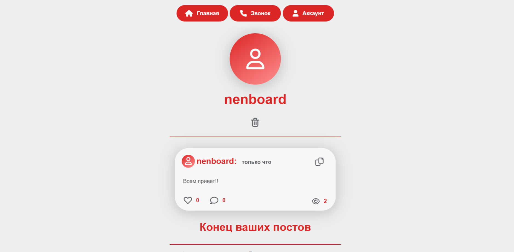

## Comma
Comma is a social network whose backend is written in C++ using SQLite3 and OpenSSL. The nlohmann JSON parser was used as the JSON parser. The site works with basic encryption. The repository contains all the files so that you can run the social network locally on your own computer or in production. The project has fixed the basic vulnerabilities (at least, the ones I noticed).

## Starting up on localhost
In order to be able to run it, you need to download file Setup.msi and run them, or:
 - create a new project in Visual Studio
 - add all the files to it
 - and in the project properties
 - add the dependencies (ws2_32.lib; wininet.lib; libssl.lib; libcrypto.lib)
 - add additional library directories (“C:\Program Files\OpenSSL-Win64\lib”; “C:\Program Files\OpenSSL-Win64\lib\VC\x64\MD"),
 - specify the Console subsystem,
 - additional include directories ("C:\Program Files\OpenSSL-Win64\include"; "C:\Users\User\source\repos\Comma\Comma")
 - and the C++ 20 standard.

## Functions
In Comma, you can:
 - to like
 - comment
 - call
 - create profiles
 - publish files or posts

## Config
In the config.txt file, you can change some server operation parameters (you cannot change the order of the configs or delete them):
 - index - main page
 - undefined - page of error 404
 - profile - page of your profile
 - room - endpoint of rooms for WebScoket
 - upload - folder for posts
 - api - api endpoint
 - admin - admin endpoint
 - https - port for https
 - http - port for http
 - memory - max memory in MB for one request
 - log - file of logs
 - key - file of key
 - crt - file of certificate
 - database - main database
 - users - users database
 - domain - domain of social network
 - developer - admin profile
 - posts - max value of account for one user in 24 hours
 - accounts - max value of account for one user
 - rooms - max value of rooms
 - limit - max value of rooms for one user

## Screenshots

